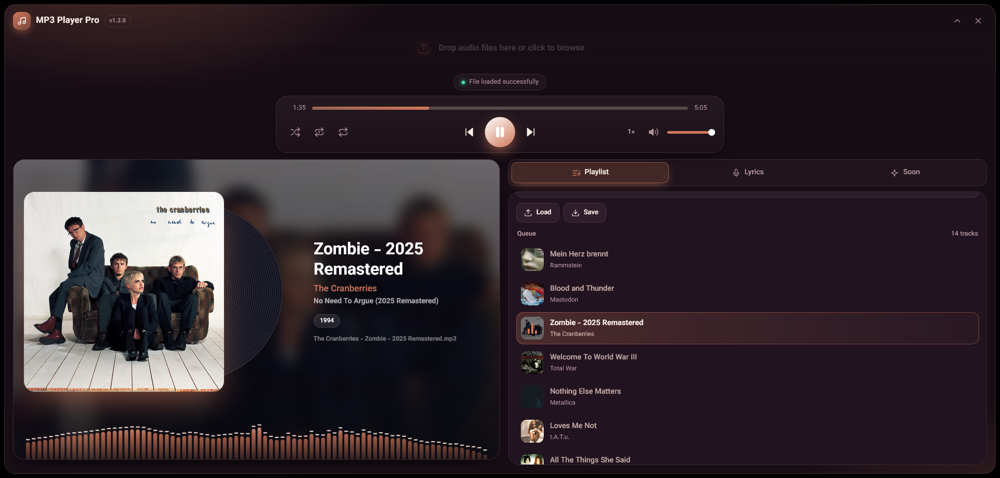
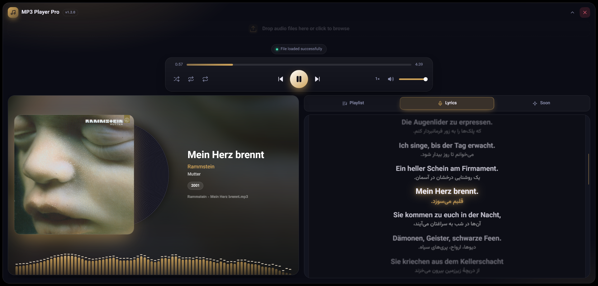
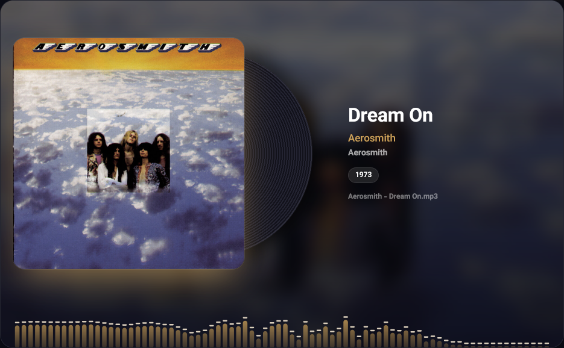
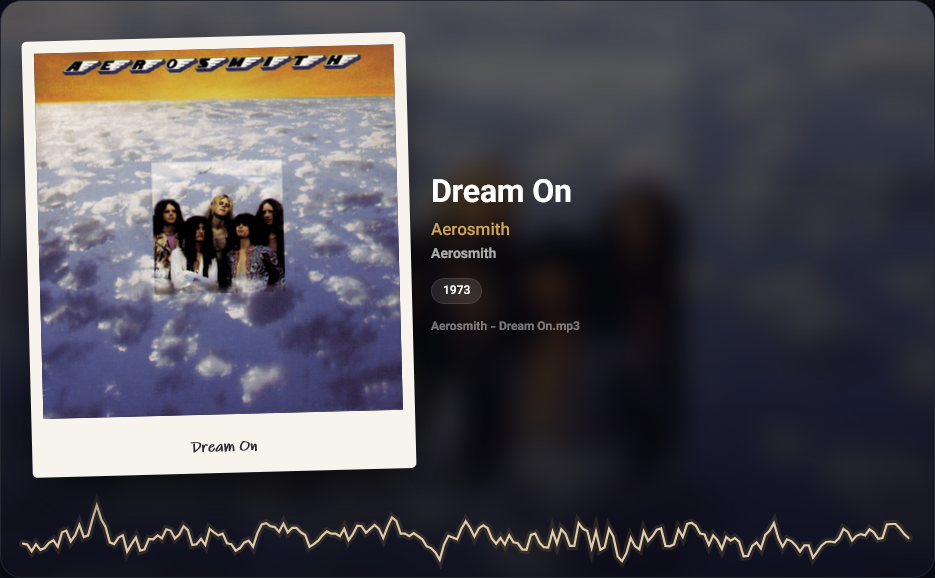
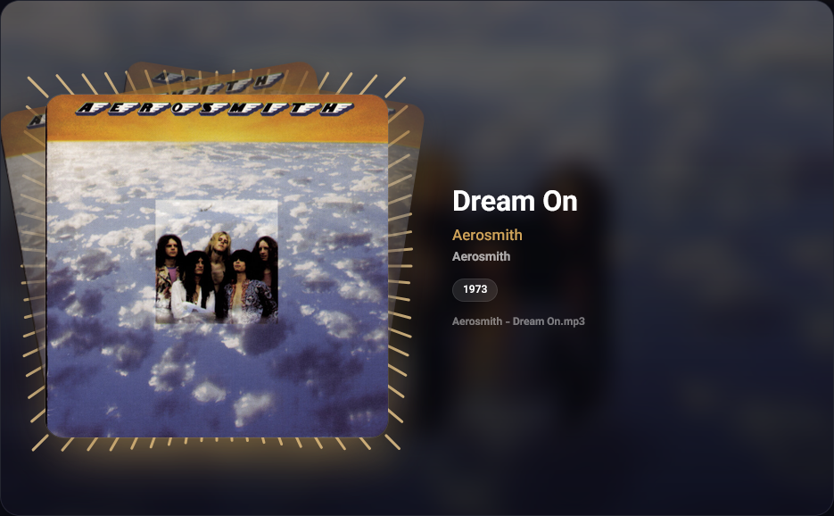
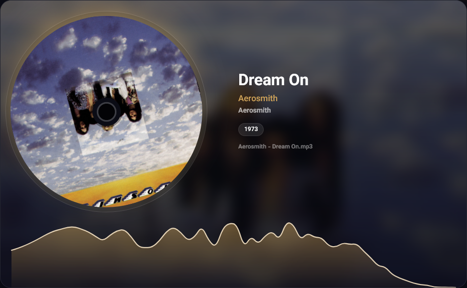
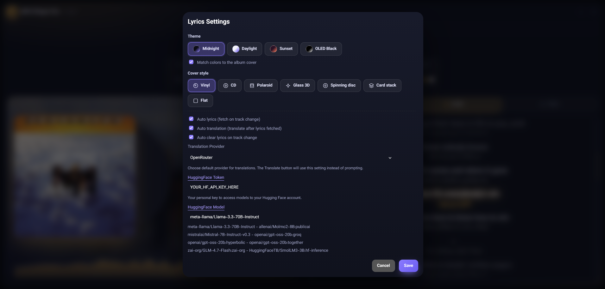

  

  # 🎵 MP3 Player Pro
  **A lightweight, high‑performance browser audio workstation — injected into any tab as a UserScript.**

---

## 📖 Table of Contents

- [Overview](#-overview)
- [What's New in 1.2.0](#-whats-new-in-120)
- [Key Features](#-key-features)
- [Screenshots](#-screenshots)
- [Installation](#-installation)
- [Usage](#-usage)
- [Keyboard Shortcuts](#-keyboard-shortcuts)
- [Supported Formats](#-supported-formats)
- [Technical Overview](#-technical-overview)
- [Security & API Keys](#-security--api-keys)
- [Browser Support](#-browser-support)
- [Troubleshooting](#-troubleshooting)
- [Contributing](#-contributing)
- [License](#-license)
- [Author](#-author)

---

## 🔎 Overview

**MP3 Player Pro** turns any browser tab into a full music workstation. Drop your local audio files anywhere on the page and the player builds a playlist, reads metadata, shows synchronized lyrics, translates them with AI, and renders a real‑time visualizer — all without leaving the tab.

It is distributed as a **UserScript** for Tampermonkey, Greasemonkey, or Violentmonkey, and is designed to be non‑intrusive: it stays in a draggable floating container and never modifies the host page's content.

---

## 🆕 What's New in 1.2.0

- **Cover‑art engine rewritten** — now reads ID3v2.2 / 2.3 / 2.4, FLAC, M4A/MP4, Ogg Vorbis and Opus. Prefers the **front cover**, recovers images even when the description field is broken, and fixes **Persian Windows‑1256** tags.
- **Never a blank cover** — a generated gradient cover is used when art is missing, when an image fails to load, or for `file:///` tracks (it also looks for `cover.jpg` / `folder.jpg` next to the file).
- **Dynamic theming from the album cover** — buttons, glow, visualizer and tabs follow the cover colour with smooth transitions.
- **4 themes** — Midnight, Daylight (light), Sunset, OLED Black.
- **7 cover styles** — Vinyl, CD, Polaroid, Glass 3D, Spinning disc, Card stack, Flat.
- **6 visualizer styles** — Bars, Mirror, Spectrum area, Waveform, Radial halo, Pulse rings.
- **Spinning vinyl** that slides out from behind the cover during playback.
- **Settings persistence** — volume, speed, loop/repeat/shuffle, lyrics/translation options and visualizer choice are saved.
- **Compact mode**, draggable header, and OS media‑control seek support.
- **Keyboard shortcuts** — Space/K, ←/→, ↑/↓, N/P, M, L, R, S.
- **Smart Prev** — restarts the track if more than 3 seconds have elapsed.
- **Playlist search** now covers title, artist and album.
- **Security & stability fixes** — XSS escaping, memory‑leak fixes, single `createMediaElementSource`, ID3v2.4 synchsafe frames, and header‑only metadata reads for large FLAC/WAV files.

> ⚠️ **Security note:** API keys for HuggingFace and OpenRouter are **no longer hardcoded**. Enter your own keys via **Lyrics Settings**; they are stored in `localStorage`. If you used a previous version, **revoke your old keys immediately** — see [Security & API Keys](#-security--api-keys).

---

## ✨ Key Features

### 📂 Instant Drag‑and‑Drop
Drop `.mp3`, `.wav`, `.ogg`, `.m4a`, `.flac` or `.opus` files — or whole folders — anywhere on the page. The playlist is built automatically; no file explorer required.

### 🎧 Seamless Playback
- **Floating UI** that stays on top and can be dragged anywhere.
- **Automatic playlist** built from dropped files, with re‑ordering and an animated equalizer on the active track.
- **Auto‑advance** to the next track, with smart **Prev** behaviour.
- **Compact mode** for a minimal footprint.

### 🤖 Synchronized Lyrics & AI Translation
- **Real‑time sync** from embedded metadata or `.lrc` files; the active line is highlighted karaoke‑style while distant lines fade and blur.
- **AI translation** with your choice of backend:
  - **Google (public)** — fast and reliable.
  - **HuggingFace** — open‑source model enthusiasts.
  - **OpenRouter** — premium LLMs for contextual translations.
- **Target‑language picker** and original/translated toggle.

### 🎚️ Advanced Visualizer (Web Audio API)
- **6 styles:** Bars (with falling peak caps), Mirror, Spectrum area, Waveform, Radial halo, Pulse rings.
- **Log‑spaced frequency bands** so bass and treble both move, with smooth rise/fall.
- **Placement:** Bars/Mirror/Area/Waveform sit in a bottom strip; Radial/Pulse form a halo that follows the cover outline.
- **Granular controls:** height, sensitivity, bar count, and bass/mid/treble balance.
- **Performance‑aware:** the canvas resizes correctly and drawing pauses when the player is hidden, collapsed, or the tab is in the background.

### 🎶 Smart Playlist Management
- **Bulk import** of entire folders.
- **Dynamic re‑ordering** with an interactive playlist drawer.
- **Search** across title, artist and album.
- **Queue control** and auto‑play.
- **Lightweight memory footprint** — blob URLs and Media Session artwork are released when no longer needed.

### 🎨 Appearance & Themes
- **4 themes:** Midnight, Daylight, Sunset, OLED Black.
- **Cover‑driven accent colour** (optional; Daylight uses a darker accent for readability).
- **7 cover styles** including Polaroid (with title caption) and Glass 3D (reflection + pointer tilt).
- **Modern SVG icons**, modal blur/entrance animations, and respect for `prefers-reduced-motion`.

---

## 🖼️ Screenshots

  

 

  

 

<table>
  <tr>
    <td align="center"></td>
    <td align="center"></td>
  </tr>
  <tr>
    <td align="center"></td>
    <td align="center"></td>
  </tr>
</table>

  

---

## 🚀 Installation

1. **Install a UserScript manager:**
   - [Tampermonkey](https://www.tampermonkey.net/) (recommended)
   - [Violentmonkey](https://violentmonkey.github.io/)
   - [Greasemonkey](https://www.greasespot.net/)
2. **Add the script:**
   - Open your manager's dashboard → **Create a new script**.
   - Paste the contents of `MP3 Player Pro.js` (v1.2.0) and save.
3. **Use it:**
   - Refresh any tab; the floating player container (`#mp3ViewerContainer`) is ready.
   - Drag audio files onto the page to start playing.

---

## 🕹️ Usage

- **Open the player:** it appears automatically after the script loads.
- **Add tracks:** drag audio files or folders onto the page.
- **Move the player:** drag the header or container background.
- **Lyrics:** shown automatically from metadata or a matching `.lrc` file.
- **Settings:** open **Lyrics Settings → Appearance** to choose theme, cover style and visualizer; changes preview live, **Cancel** reverts, **Save** persists.

### ⌨️ Keyboard Shortcuts

| Key | Action |
|-----|--------|
| `Space` / `K` | Play / pause |
| `←` / `→` | Seek ±5 s (`Shift` = ±15 s) |
| `↑` / `↓` | Volume up / down |
| `N` / `P` | Next / previous track |
| `M` | Mute |
| `L` | Toggle lyrics |
| `R` | Cycle repeat mode |
| `S` | Toggle shuffle |

> Shortcuts are ignored while typing in an input field.

---

## 🎵 Supported Formats

| Purpose | Formats |
|---------|---------|
| **Playback** | MP3, WAV, OGG, M4A, FLAC, Opus (browser‑dependent) |
| **Metadata / cover art** | ID3v2.2, ID3v2.3, ID3v2.4, FLAC, M4A/MP4, Ogg Vorbis, Opus |
| **Lyrics** | Embedded synchronized lyrics, `.lrc` files |

Cover art falls back to `cover.jpg` / `folder.jpg` next to `file:///` tracks, and to a generated gradient cover when nothing is available.

---

## 🛠️ Technical Overview

- **Engine:** JavaScript ES6+ with jQuery.
- **Audio:** Web Audio API (`AudioContext`, `AnalyserNode`) with a single `MediaElementSource` per element.
- **Rendering:** CSS3 transforms and `DOMMatrix` for precise dragging; `requestAnimationFrame` for 60 FPS animation.
- **Metadata:** header‑only ID3/FLAC/MP4/Ogg parsing (no full‑file reads for large files).
- **Security:** all tag, filename and lyric strings are HTML‑escaped before rendering.
- **Persistence:** user settings stored in `localStorage`.
- **Accessibility:** honours `prefers-reduced-motion`.

---

## 🔐 Security & API Keys

- **No keys ship with the script.** HuggingFace tokens and OpenRouter keys were removed in 1.2.0.
- Enter your own keys in **Lyrics Settings**; they are stored only in your browser's `localStorage`.
- **If you used a version before 1.2.0, revoke any keys you had configured** — the old file contained hardcoded credentials and may have been shared.
- Never commit API keys to a public repository.

---

## 🌐 Browser Support

| Browser | Status |
|---------|--------|
| Chrome / Edge (Chromium) | ✅ Recommended |
| Firefox | ✅ Supported |
| Safari | ⚠️ Mostly supported; some Web Audio behaviours differ |
| Mobile browsers | ⚠️ Limited (UserScript managers vary) |

Requires a UserScript manager and a browser with Web Audio API support.

---

## 🩺 Troubleshooting

- **No cover shown?** The file may lack embedded art; the generated gradient cover is used. For `file:///` tracks, place `cover.jpg` or `folder.jpg` beside the file.
- **Persian text looks wrong?** 1.2.0 fixes Windows‑1256 tags; re‑import the file if it was cached.
- **Translation fails?** Check that your API key is set in Lyrics Settings and has quota.
- **Autoplay blocked?** Browsers require a user gesture before audio can start — click play once.
- **Fonts look different on macOS/Linux?** The Polaroid caption uses *Ink Free* (Windows); it falls back to a serif elsewhere. Vazirmatn loads from the network and falls back to a system font offline.

---

## 🤝 Contributing

Issues and pull requests are welcome. Please:
1. Open an issue describing the bug or feature.
2. Keep changes focused and test in a real browser with sample audio files.
3. Follow the existing code style and escape any user‑derived strings.

---

## 📜 License

Licensed under the **GNU Affero General Public License v3.0 (AGPL‑3.0)**. See the [full license text](https://www.gnu.org/licenses/agpl-3.0) and the script header for details. Because this is a network‑delivered UserScript, the AGPL's network‑use clause applies: if you modify and redistribute it as a service, you must make the source available.

---

## 👤 Author

**Ali Ashori**
🌐 [i-ali.ir](https://i-ali.ir/)
🐙 [github.com/AliAshori78](https://github.com/AliAshori78)
📧 Reach out for suggestions or bug reports.

---

*This script is intended for personal use and to enhance your browsing experience. Always ensure you have the rights to the music you play.*
